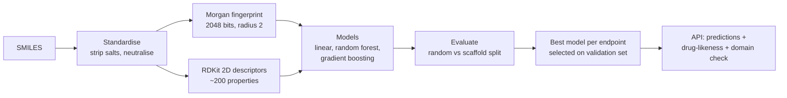
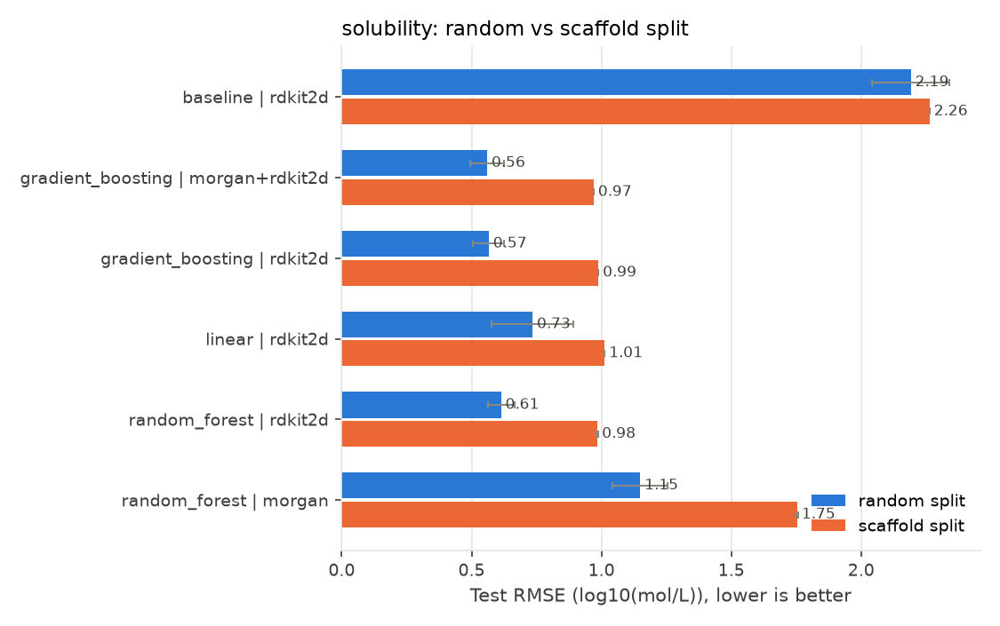
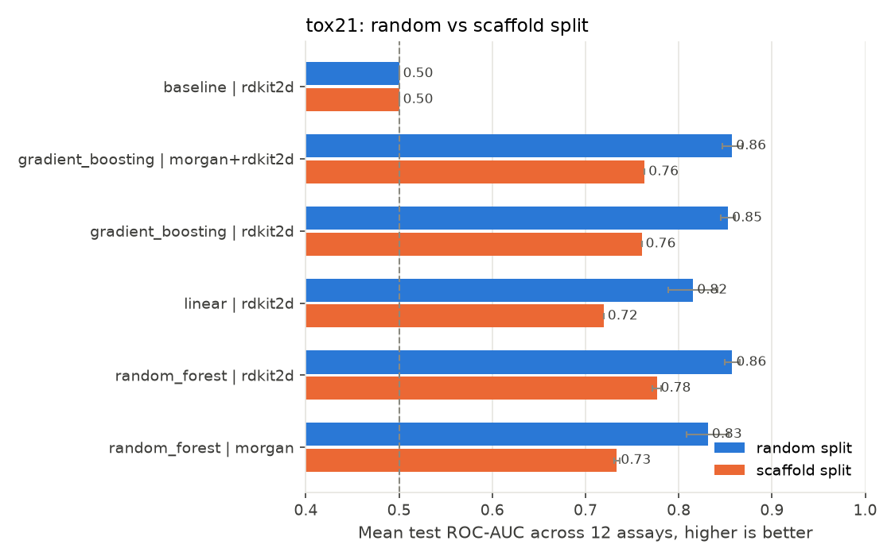
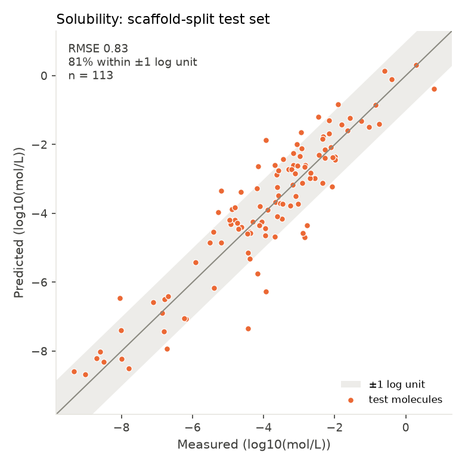

# admet-predictor

Machine-learning models that predict **ADMET** properties of drug candidates (Absorption, Distribution, Metabolism, Excretion, Toxicity) directly from molecular structure, evaluated the way medicinal chemists actually use them: on chemical series the model has never seen.


## Why this matters

Most drug candidates fail not because they miss their target, but because they dissolve poorly, are toxic, or never reach the right tissue. Testing every design in the lab is slow and expensive, so discovery teams use computational models to triage molecules before synthesis. A model is only useful for that if it works on **new chemistry**, which is exactly where naive benchmarks overestimate performance.

## What it predicts

| Endpoint | ADMET | Data | Task |
|---|---|---|---|
| Aqueous solubility (logS) | Absorption | ESOL, 1,128 molecules | Regression |
| Tox21 panel: 12 nuclear-receptor and stress-response assays | Toxicity | Tox21, 8,014 molecules | 12 binary classifiers |

For every molecule the API also reports a **drug-likeness profile** (molecular weight, logP, polar surface area, H-bond donors/acceptors, Lipinski rule-of-five violations, QED score) and an **applicability-domain check** that flags molecules too different from the training data to trust.

## Approach



**1. Standardisation.** Salts and solvents are stripped and charges neutralised, so "sodium acetate" and "acetic acid" are treated as the same parent structure.

**2. Two representations.** Morgan fingerprints capture local substructures ("contains a carboxylic acid"); RDKit descriptors capture global physicochemistry (logP, polar surface area). Solubility depends heavily on the latter, receptor binding more on the former, so both are compared and combined.

**3. Models.** Ridge/logistic regression, random forest, and histogram gradient boosting, always alongside a naive baseline that predicts the training mean (regression) or active rate (classification). Toxicity classifiers use class weighting because actives are rare (2-16% per assay).

**4. Two splits.**
- *Random split* - molecules shuffled into 80/10/10 train/validation/test.
- *Scaffold split* - molecules grouped by their Bemis-Murcko scaffold (the ring system core), and whole groups assigned to one partition. Every test molecule belongs to a chemical series absent from training.

The gap between the two is the key result: it shows how much of a model's apparent accuracy comes from recognising close relatives rather than understanding chemistry.

**5. Honest selection.** The production model for each endpoint is chosen on the **validation** set of the scaffold split, its performance reported on the untouched **test** set, and only then refitted on all data. The test set never influences any choice.

**6. Metrics.** Solubility: RMSE and MAE (log units), R², and Spearman rank correlation. Toxicity: ROC-AUC averaged over the 12 assays, plus **PR-AUC**, which is more informative for rare actives (a random model's PR-AUC equals the active rate).

## Results

Six model configurations, both splits, three random seeds. Full tables with
standard deviations are in [`reports/benchmark.md`](reports/benchmark.md).

### Solubility — RMSE in log units, lower is better

| Model | Random split | Scaffold split |
|---|---|---|
| Baseline (predict training mean) | 2.191 | 2.263 |
| Random forest + fingerprints | 1.149 | 1.754 |
| Linear + descriptors | 0.734 | 1.012 |
| Random forest + descriptors | 0.613 | 0.985 |
| Gradient boosting + descriptors | 0.566 | 0.988 |
| **Gradient boosting + both** | **0.560** | **0.970** |

### Tox21 — ROC-AUC averaged over 12 assays, higher is better

| Model | Random split | Scaffold split |
|---|---|---|
| Baseline (predict active rate) | 0.500 | 0.500 |
| Linear + descriptors | 0.815 | 0.720 |
| Random forest + fingerprints | 0.831 | 0.734 |
| Gradient boosting + descriptors | 0.853 | 0.760 |
| Gradient boosting + both | 0.857 | 0.763 |
| **Random forest + descriptors** | **0.857** | **0.776** |





### What the numbers say

**1. The scaffold split is substantially harder, which is the point.** Solubility
RMSE rises from 0.560 to 0.970 log units and R² falls from 0.932 to 0.766. Tox21
ROC-AUC falls from 0.857 to 0.776, and PR-AUC — the metric that matters for rare
actives — from 0.529 to 0.401. Reporting only the random-split numbers would
overstate real-world performance by roughly that margin.

**2. Fingerprints memorise; descriptors generalise.** This is the clearest result
in the benchmark. On solubility, going from the random to the scaffold split:

| Features | R² (random) | R² (scaffold) | Relative loss |
|---|---|---|---|
| Morgan fingerprints | 0.723 | 0.234 | **−68%** |
| RDKit descriptors | 0.919 | 0.758 | −18% |

Fingerprints record which substructures a molecule contains, so they work well
when the test set shares chemistry with training and collapse when it does not.
Physicochemical descriptors (logP, polar surface area, molecular weight) encode
bulk properties that transfer to unseen scaffolds. The gap is far smaller on
Tox21 (0.831 → 0.734 for fingerprints), which is consistent with receptor
binding depending on specific substructures in a way that bulk solubility
does not.

**3. Solubility is close to linear.** Ridge regression on descriptors reaches
1.012 RMSE on the scaffold split against 0.970 for the best gradient-boosted
model — a 4% difference. This independently reproduces Delaney's 2004 finding,
where the original ESOL equation was a linear fit on a handful of descriptors.
Worth remembering before reaching for a graph neural network.

**4. The baseline is worse than useless on unseen chemistry.** Predicting the
training mean gives R² of −0.275 on the solubility scaffold split: unseen
scaffolds have a different solubility distribution, so the training mean is
actively misleading. On Tox21 the baseline's PR-AUC equals the active rate
(0.079 random, 0.105 scaffold), which is exactly what a random ranker scores,
and the best model's 0.401 is roughly four times that.

Reproduce with `make benchmark && make train` (30-60 minutes). Numbers were
produced with Python 3.14, RDKit 2026.09.1 and scikit-learn 1.9.1; small
variations across library versions are expected. CI runs a shortened benchmark
on every push and uploads the output as an artifact.

## Quick start

```bash
git clone https://github.com/shreyadevi/admet-predictor.git
cd admet-predictor
python -m venv .venv && source .venv/bin/activate
make install      # pip install -e ".[dev,api]"
make test
make train        # ~5-15 minutes
```

### Command line

```bash
admet predict "CC(=O)Oc1ccccc1C(=O)O"          # aspirin
```

```jsonc
{
  "input": "CC(=O)Oc1ccccc1C(=O)O",
  "valid": true,
  "canonical_smiles": "CC(=O)Oc1ccccc1C(=O)O",
  "properties": { "molecular_weight": 180.16, "logp": 1.31, "tpsa": 63.6,
                  "lipinski_violations": 0, "qed": 0.55, ... },
  "solubility": { "value": ..., "units": "log10(mol/L)", "category": "...",
                  "nearest_training_similarity": ..., "in_domain": true },
  "tox21": { "probabilities": { "NR-AR": ..., "SR-p53": ... },
             "flagged_assays": [...], "in_domain": true, ... }
}
```

### API

```bash
make serve                       # http://localhost:8080/docs for interactive docs

curl -X POST localhost:8080/predict \
     -H 'Content-Type: application/json' \
     -d '{"smiles": ["CC(=O)Oc1ccccc1C(=O)O", "CN1C=NC2=C1C(=O)N(C(=O)N2C)C"]}'
```

| Route | Purpose |
|---|---|
| `GET /health` | Liveness check, lists loaded endpoints |
| `GET /models` | Which model was selected per endpoint and its test metrics |
| `POST /predict` | Up to 100 SMILES per request |

### Docker

```bash
make docker-build    # trains the models inside the image
make docker-run      # serves on port 8080
```

The container reads `$PORT`, runs as a non-root user, and is ready for Google Cloud Run.

## Applicability domain

For each query, the API reports the highest Tanimoto similarity between its fingerprint and any training molecule. Below 0.3, `in_domain` is `false`: the molecule is unlike anything the model learned from, and its prediction should be treated as a rough guess. This is computed with NumPy on bit-packed fingerprints, so the 8,000-molecule reference set takes about 2 MB.

## Project layout

```
src/admet/
├── featurize.py      SMILES standardisation, fingerprints, descriptors, scaffolds (RDKit)
├── splits.py         Random and scaffold splits
├── models.py         Model configurations and baselines
├── metrics.py        Regression and classification metrics
├── applicability.py  Tanimoto nearest-neighbour domain check
├── pipeline.py       Benchmarking, model selection, training
├── report.py         Markdown tables and figures
├── predict.py        Predictor class with drug-likeness profile
└── cli.py            `admet benchmark | train | predict`
api/app.py            FastAPI service
data/                 ESOL and Tox21 (see data/README.md for sources)
tests/                Unit, pipeline, chemistry and API tests
```

## Testing

| Tests | What they cover |
|---|---|
| `test_splits.py` | No scaffold is shared across partitions; largest series go to training; reproducibility |
| `test_metrics_and_ad.py` | Metric values on known cases; Tanimoto maths; fingerprint packing |
| `test_pipeline.py` | Full benchmark → summary → report → training flow on synthetic data, with a stand-in featuriser; models beat the baseline; strict JSON output |
| `test_chemistry.py` | Featurisation, salt stripping, scaffolds, a real solubility model beating a quality bar, predictions and the API |

CI runs lint and the full suite on Python 3.10 and 3.12, benchmarks and trains the models, and builds the Docker image and calls the API inside it. Benchmark reports are uploaded as an artifact on every run.

## Limitations

- ESOL is small (1,128 molecules) and Tox21 covers 12 specific assays; neither captures all of absorption or toxicity.
- In-vitro assay activity is not the same as toxicity in humans.
- Predictions are for research and education, not for clinical or regulatory decisions.

## Possible extensions

- Graph neural networks (e.g. Chemprop) for comparison against fingerprint models
- More endpoints: blood-brain barrier penetration, hERG cardiotoxicity, CYP inhibition, lipophilicity
- Uncertainty estimates from forest variance or conformal prediction
- Deployment to Cloud Run with Terraform, reusing [gcp-terraform-platform](https://github.com/shreyadevi/gcp-terraform-platform)

## References

- Wu Z. et al. (2018) MoleculeNet: a benchmark for molecular machine learning. *Chemical Science* 9, 513-530.
- Delaney J.S. (2004) ESOL: Estimating aqueous solubility directly from molecular structure. *J. Chem. Inf. Comput. Sci.* 44, 1000-1005.
- Bemis G.W., Murcko M.A. (1996) The properties of known drugs. 1. Molecular frameworks. *J. Med. Chem.* 39, 2887-2893.
- Rogers D., Hahn M. (2010) Extended-connectivity fingerprints. *J. Chem. Inf. Model.* 50, 742-754.
- Bickerton G.R. et al. (2012) Quantifying the chemical beauty of drugs. *Nature Chemistry* 4, 90-98.
- Lipinski C.A. et al. (1997) Experimental and computational approaches to estimate solubility and permeability in drug discovery and development settings. *Adv. Drug Deliv. Rev.* 23, 3-25.
- RDKit: Open-source cheminformatics, https://www.rdkit.org

## License

MIT. See [LICENSE](LICENSE).
